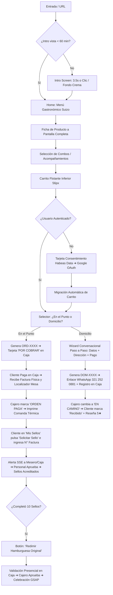
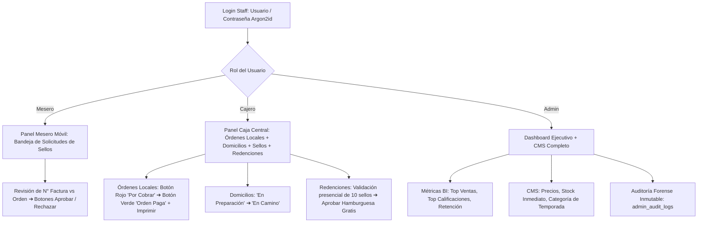

# 03. Flujos de la Aplicación y Diagramas de Navegación (APP FLOW)

**Proyecto:** Mías.8 Hamburguesas de Lujo  
**Versión:** 1.0.0  
**Estado:** Normativo / Aprobado  

---

## 1. Mapa de Navegación General

---

## 2. Flujo del Personal (Mesero, Cajero, Admin)

